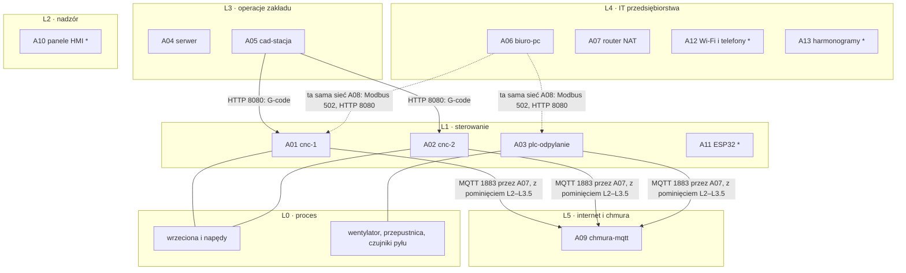

# Inwentaryzacja aktywów (stan as-is, `v0`)

Etap 1, zadanie T03. Tabela obejmuje wszystkie kontenery labu `v0` ([lab/v0/compose.yaml](../../lab/v0/compose.yaml)) i aktywa ze scenariusza, które nie mają odpowiednika w labie (oznaczone „poza symulacją”). Z niej wychodzą przepływy danych (T04), strefy i poziomy Purdue stanu docelowego (T05) oraz SL-T (T06).

Poziom Purdue wynika z funkcji aktywa, a nie z miejsca w sieci. W `v0` sieć tego podziału nie odzwierciedla: wszystkie aktywa labu z poziomów L1–L4 siedzą w jednej podsieci 10.10.0.0/24.

## Skale

**Poziomy Purdue** (model uproszczony, jak w instrukcji projektu):

| Poziom | Co obejmuje |
|---|---|
| L0 | proces fizyczny: wrzeciona, napędy, wentylator, czujniki |
| L1 | sterowanie: PLC, sterowniki CNC, węzły brzegowe przy maszynach |
| L2 | nadzór: panele HMI, SCADA |
| L3 | operacje zakładu: serwer projektów, stacja CAM wysyłająca programy (DNC) |
| L3.5 | IDMZ między IT i OT: w `v0` nie istnieje |
| L4 | IT przedsiębiorstwa: biuro, Wi-Fi, systemy planowania |
| L5 | internet i usługi chmurowe |

**Właściciel:** IT to zewnętrzny outsourcing IT, OT to lokalni automatycy. Aktywa, o które te dwie strony się spierają, opisujemy niżej.

**Krytyczność** (najgorszy realny skutek ataku albo awarii):

| Krytyczność | Skutek |
|---|---|
| Krytyczna | zagrożenie dla ludzi albo zatrzymanie produkcji |
| Wysoka | przestój części produkcji, wadliwe wyroby albo wyciek projektów |
| Średnia | utrudnienie pracy z możliwym obejściem ręcznym |
| Niska | brak bezpośredniego wpływu na produkcję |

## Tabela aktywów

| ID | Aktywo | W labie | Purdue | Adres v0 | Protokoły i porty | Właściciel | Krytyczność |
|---|---|---|---|---|---|---|---|
| A01 | Obrabiarka CNC 1 | `cnc-1` | L1 (L0: wrzeciono, napędy) | 10.10.0.11 | HTTP 8080/tcp (przyjmuje: `POST /program`, `GET /status`); MQTT 1883/tcp do chmury | OT | Krytyczna |
| A02 | Obrabiarka CNC 2 | `cnc-2` | L1 (L0: wrzeciono, napędy) | 10.10.0.12 | jak A01 | OT | Krytyczna |
| A03 | PLC centralnego odpylania | `plc-odpylanie` | L1 (L0: wentylator, przepustnica, czujniki) | 10.10.0.21 | Modbus TCP 502/tcp (przyjmuje); MQTT 1883/tcp do chmury | OT | Krytyczna |
| A04 | Serwer projektów we współdzielonej serwerowni | `serwer` | L3 | 10.10.0.31 | HTTP 80/tcp (`/projekty/*.nc`) | IT | Wysoka |
| A05 | Stacja CAD/CAM konstruktora | `cad-stacja` | L3 | 10.10.0.41 | brak usług; klient HTTP 80/tcp do A04 i HTTP 8080/tcp do A01, A02 | IT | Wysoka |
| A06 | Komputer biurowy (w labie przejęty) | `biuro-pc` | L4 | 10.10.0.66 | brak usług; w labie narzędzia ataku (nmap, tcpdump, arpspoof, scapy, mosquitto-clients, pymodbus) | IT | Średnia |
| A07 | Router zakładowy z NAT | `router` | L4 (brzeg z L5) | 10.10.0.254, 203.0.113.2 | routing IPv4 i NAT (nftables), bez filtrowania | IT | Wysoka |
| A08 | Sieć zakładu: wspólny przełącznik biura, serwerowni i hali | sieć `zaklad` | L1–L4 (wspólna) | 10.10.0.0/24 | Ethernet; cały ruch lokalny (HTTP, Modbus TCP, MQTT) | IT | Krytyczna |
| A09 | Broker MQTT w chmurze | `chmura-mqtt` | L5 | 203.0.113.10 | MQTT 1883/tcp, bez TLS, anonimowy, bez ACL | OT | Krytyczna |
| A10 | Panele HMI operatorów (obrabiarki, szafa odpylania) | poza symulacją | L2 | — | lokalne sterowanie maszynami i odpylaniem (Modbus TCP 502/tcp do A03); w labie START/STOP idzie tylko przez MQTT | OT | Wysoka |
| A11 | Węzeł ESP32 z czujnikiem prądu wrzeciona | poza symulacją | L1 (L0: przekładnik prądowy) | — | Wi-Fi, MQTT; w `v1` emulowany w QEMU (Etap 5) | OT | Wysoka |
| A12 | Wi-Fi biura i hali z telefonami pracowników | poza symulacją | L4 | — | Wi-Fi z hasłem wspólnym, ta sama pula adresów co hala | IT | Wysoka |
| A13 | Harmonogramy produkcji (ERP albo arkusze) | poza symulacją | L4 | — | HTTPS, udział plików | IT | Średnia |

## Funkcja i przetwarzane dane

| ID | Funkcja | Przetwarzane dane | Uzasadnienie krytyczności |
|---|---|---|---|
| A01, A02 | frezowanie elementów mebli według programu G-code | program G-code; telemetria co 1 s: prąd i obroty wrzeciona, posuw, głębokość Z, temperatura; komendy START/STOP | zatrzymanie to przestój; podmieniony program daje wadliwe wyroby i może przeciążyć wrzeciono (prąd do 30 A); niespodziewany START zagraża operatorowi |
| A03 | sterowanie wentylatorem wyciągowym i przepustnicą, pomiar podciśnienia i stężenia pyłu | cewki: wentylator, przepustnica; rejestry: obroty, podciśnienie, pył; stan co 1 s po MQTT | po wyłączeniu wentylatora stężenie pyłu drzewnego po około minucie przekracza próg alarmu (50 mg/m³ w symulacji): ryzyko wybuchu pyłu i zagrożenie dla zdrowia |
| A04 | przechowywanie projektów i programów dla maszyn | projekty CAD i G-code (`blat-stolu.nc`, `front-szafki.nc`) | wyciek to utrata własności intelektualnej eksportera mebli; zmieniony plik trafia na maszyny |
| A05 | co 30 s pobiera program z A04 i wysyła go na kolejną obrabiarkę | G-code; SHA-256 wysłanego pliku w logu | program idzie z niej prosto na maszynę, bez kontroli integralności |
| A06 | praca biurowa: poczta, dokumenty, przeglądarka | dokumenty firmowe, poświadczenia użytkownika | sam nie steruje produkcją, ale w płaskiej sieci jest gotowym punktem wejścia do OT |
| A07 | wyjście zakładu do internetu | cały ruch do chmury, w tym jawna telemetria MQTT | awaria odcina chmurę, a maszyny pracują dalej; przejęcie daje podsłuch i modyfikację całego ruchu do chmury |
| A08 | jedna sieć L2 dla wszystkich urządzeń | cały ruch lokalny | awaria zatrzymuje wysyłkę programów i sterowanie odpylaniem; brak podziału pozwala każdemu urządzeniu połączyć się z każdym |
| A09 | odbiór telemetrii i przekazywanie komend do maszyn | telemetria wszystkich maszyn, stan odpylania, komendy START/STOP | kto opublikuje na `wood-tech/hala1/<cnc>/komenda`, ten zatrzyma albo uruchomi obrabiarkę |
| A10 | podgląd stanu i lokalne sterowanie maszynami i odpylaniem przez operatora | stan maszyn i odpylania, komendy operatora | bez HMI operator traci podgląd i szybkie zatrzymanie z panelu |
| A11 | pomiar prądu wrzeciona; w `v1` lokalna detekcja anomalii (TinyML) i alarm bez chmury | próbki prądu | bez niego zmieniony program albo przeciążenie wykryjemy dopiero po skutkach |
| A12 | dostęp do sieci dla biura i hali | ruch pracowników i ich telefonów | dowolny telefon z hasłem do Wi-Fi jest w tej samej sieci co maszyny |
| A13 | planowanie zleceń na maszyny | harmonogramy produkcji | błędny plan opóźnia zlecenia, ale da się go poprawić ręcznie |

## Dane

Ocena wpływu naruszenia poufności (P), integralności (I) i dostępności (D) danych ze scenariusza.

| Dane | Gdzie są | P | I | D |
|---|---|---|---|---|
| Projekty CAD i programy G-code | A04, A05, A01, A02 (jawnym HTTP) | wysoka | krytyczna | średnia |
| Parametry pracy wrzecion (telemetria) | A01, A02 → A09 (jawnym MQTT) | średnia | wysoka (dane do modelu AI) | średnia |
| Komendy START/STOP | A09 → A01, A02 | niska | krytyczna | wysoka |
| Stan i nastawy odpylania | A03 (Modbus), A09 | niska | krytyczna | krytyczna |
| Harmonogramy produkcji | A13 | średnia | średnia | średnia |

## Aktywa na poziomach Purdue

\* poza symulacją. W `v0` wszystkie aktywa labu z L1–L4 są w jednej sieci A08, więc podział na poziomy istnieje tylko na tym schemacie.

## Wnioski

1. **Brak granic między poziomami.** Biuro (L4) łączy się wprost z PLC i obrabiarkami (L1). Potwierdzają to testy `v0` w [tests/security](../../tests/security/test_v0_podatnosci.py).
2. **Urządzenia L1 rozmawiają bezpośrednio z chmurą (L5).** Nie ma lokalnej bramki ani IDMZ. W `v1` dane do chmury wyjdą tylko przez Node-RED w IDMZ.
3. **Najbardziej krytyczne są A03, A01, A02, A09 i A08.** Wyłączenie odpylania (A03) to jedyne zagrożenie dla ludzi, a broker w chmurze (A09) bez ACL pozwala sterować maszynami z internetu.
4. **Projekty CAD i G-code mają najwyższe wymagania integralności i poufności.** To podstawa scenariusza Tampering w Etapie 4.
5. **Spór IT/OT o współdzielone aktywa.** Sporne są:
   - serwer projektów (A04): sprzęt należy do IT, a treść do produkcji;
   - stacja CAD/CAM (A05): obsługuje ją IT, a decyduje o programach na maszynach;
   - router (A07): obsługuje go IT, ale przechodzi przez niego ruch OT do chmury;
   - broker w chmurze (A09): zakładamy, że automatycy uruchomili go bez udziału IT.

   Przy podziale na strefy w T05 każde z nich dostaje jednego właściciela.

Poza zakresem inwentaryzacji jest host labu (Debian z Dockerem): to infrastruktura symulacji, a nie aktywo fabryki. Aktywa dochodzące w `v1` (lokalny broker MQTT, Node-RED, zapory fw-it i fw-ot, ESP32 w QEMU) opisze T05.
