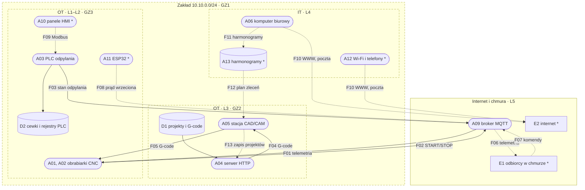

# Przepływy danych (DFD, stan as-is, `v0`)

Etap 1, zadanie T04. Diagram i tabela pokazują, jakie dane płyną między aktywami z [inwentaryzacji](inwentaryzacja-aktywow.md) (identyfikatory `Axx`), jakim protokołem i przez które granice zaufania. Są podstawą analizy STRIDE (Etap 4) i reguł zapór w `v1` (T05).

Przepływy F01–F05 działają w labie, co potwierdza nagrany ruch (sekcja [Ruch w labie](#ruch-w-labie)). Przepływy oznaczone `*` wynikają ze scenariusza, ale lab ich nie symuluje.

## Granice zaufania

| ID | Granica | Między | Stan w `v0` |
|---|---|---|---|
| GZ1 | zakład ↔ internet i chmura | L1–L4 ↔ L5 | jedyne przejście to router A07, który robi tylko NAT i niczego nie filtruje |
| GZ2 | IT ↔ OT | L4 (biuro, Wi-Fi) ↔ L1–L3 | istnieje tylko organizacyjnie (outsourcing IT kontra automatycy); w sieci jej nie ma, bo wszystko jest w 10.10.0.0/24 |
| GZ3 | operacje zakładu ↔ komórka produkcyjna | L3 ↔ L1–L2 | w sieci jej nie ma; przez nią G-code trafia na maszyny |

## Encje zewnętrzne

| ID | Encja | Opis |
|---|---|---|
| E1 | odbiorcy danych w chmurze * | panel i analityka dostawcy chmury: subskrybują telemetrię i wysyłają komendy |
| E2 | internet * | strony WWW i poczta, z których korzystają biuro i telefony pracowników |

## Diagram



Kształty: zaokrąglony to proces (aktywo, które przetwarza dane), walec to magazyn danych, prostokąt to encja zewnętrzna. Linia ciągła to przepływ w labie, przerywana to przepływ poza symulacją (`*`). Przerywane ramki to granice zaufania. Strzałka pokazuje kierunek danych; stronę, która otwiera połączenie, podaje tabela.

## Tabela przepływów

Kolumna „Inicjator” to strona, która otwiera połączenie. Od niej zależą reguły zapór w `v1`.

| ID | Skąd → dokąd | Inicjator | Protokół i port | Dane | Szyfrowanie | Uwierzytelnienie | Granice |
|---|---|---|---|---|---|---|---|
| F01 | A01, A02 → A09 | A01, A02 | MQTT 1883/tcp przez NAT A07 | telemetria co 1 s, QoS 0, temat `wood-tech/hala1/<cnc>/telemetria` | brak | brak: klient anonimowy, tylko identyfikator klienta | GZ1 |
| F02 | A09 → A01, A02 | A01, A02 | MQTT 1883/tcp, to samo połączenie co F01 | komendy START/STOP, QoS 1, temat `wood-tech/hala1/<cnc>/komenda` | brak | brak: komendę może opublikować każdy klient brokera | GZ1 |
| F03 | A03 → A09 | A03 | MQTT 1883/tcp przez NAT A07 | stan odpylania co 1 s: wentylator, przepustnica, obroty, podciśnienie, pył; temat `wood-tech/hala1/odpylanie/stan` | brak | brak | GZ1 |
| F04 | A04 → A05 | A05 | HTTP 80/tcp, `GET /projekty/<plik>.nc` | program G-code | brak | brak | — |
| F05 | A05 → A01, A02 | A05 | HTTP 8080/tcp, `POST /program` | program G-code z nazwą w nagłówku `X-Program`; w odpowiedzi SHA-256 wczytanego pliku | brak | brak; obrabiarka przyjmuje każdy program, bez kontroli integralności | GZ3 |
| F06 * | A09 → E1 | E1 | MQTT 1883/tcp | telemetria maszyn i stan odpylania (subskrypcja) | brak | brak | — |
| F07 * | E1 → A09 | E1 | MQTT 1883/tcp | komendy START/STOP | brak | brak | — |
| F08 * | A11 → A09 | A11 | MQTT 1883/tcp przez Wi-Fi i NAT A07 | pomiary prądu wrzeciona | brak | brak | GZ1 |
| F09 * | A10 → A03 | A10 | Modbus TCP 502/tcp | odczyt rejestrów (obroty, podciśnienie, pył), zapis cewek (wentylator, przepustnica) | brak | brak: Modbus nie ma uwierzytelnienia | — |
| F10 * | A06, A12 → E2 | A06, A12 | HTTPS 443/tcp i poczta przez NAT A07 | strony WWW, poczta, pobierane pliki | TLS | konta użytkowników w usługach zewnętrznych | GZ1 |
| F11 * | A06 → A13 | A06 | HTTPS 443/tcp albo udział plików SMB 445/tcp | harmonogramy produkcji | zależy od systemu | konto użytkownika | — |
| F12 * | A13 → A05 | A05 | HTTPS 443/tcp albo udział plików SMB 445/tcp | plan zleceń: który program na którą maszynę | zależy od systemu | konto użytkownika | GZ2 |
| F13 * | A05 → A04 | A05 | udział plików SMB 445/tcp (założenie) | zapis projektów CAD i programów G-code | brak (założenie) | konto użytkownika (założenie) | — |

## Ruch w labie

Ruch nagraliśmy na działającym labie `v0` w normalnej pracy, bez przejętego komputera biurowego: 140 s od startu kontenerów, na obu mostach Dockera (sieć zakładu i „internet” za NAT). Nagrania są w [evidence/etap-1-2/](../../evidence/etap-1-2/) (`v0-zaklad.pcap`, `v0-internet.pcap`), a lista połączeń w [v0-polaczenia.txt](../../evidence/etap-1-2/v0-polaczenia.txt). Odtworzenie na Debianie, bez sudo i bez tcpdump na hoście:

```bash
make v0-down
make v0-nagranie CZAS=140   # nagrywanie rusza przed kontenerami, żeby złapać połączenia MQTT
make v0-przeplywy PCAP=evidence/v0-<data>-zaklad.pcap
```

| Połączenie w ruchu | Przepływ |
|---|---|
| 10.10.0.11, 10.10.0.12 → 203.0.113.10:1883, po jednym połączeniu | F01 i F02 |
| 10.10.0.21 → 203.0.113.10:1883 | F03 |
| 10.10.0.41 → 10.10.0.31:80, co 30 s | F04 |
| 10.10.0.41 → 10.10.0.11:8080 i 10.10.0.12:8080, na przemian co 30 s | F05 |
| 203.0.113.2 → 203.0.113.10:1883, 3 połączenia po stronie internetu | F01–F03 po NAT routera A07 |

Poza tym w ruchu jest tylko ARP, a na Debianie także kilka pakietów ICMPv6 z adresu link-local mostu (MLD i wykrywanie duplikatów adresu) w pierwszych sekundach po jego utworzeniu. Wysyła je system hosta, a lab nie używa IPv6, więc nie są przepływami danych. Nazw nie rozwiązuje DNS w sieci: kontenery dostają adresy z wbudowanego resolvera Dockera i z wpisu `mqtt.chmura.example` w `/etc/hosts`. Z treści pakietów da się odczytać tematy MQTT, telemetrię, nazwy plików i cały G-code, co rozwija Etap 3 (T08).

## Co sieć umożliwia poza przepływami

Płaska sieć pozwala na połączenia, których nie ma w żadnym przepływie. To one są ścieżkami ataku, które zapory `v1` mają zamknąć:

- każde urządzenie w 10.10.0.0/24 łączy się z PLC na Modbus 502 (A03), choć legalnie robi to tylko panel HMI (F09);
- każde urządzenie wysyła program na obrabiarkę na port 8080, choć legalnie robi to tylko stacja CAD/CAM (F05);
- każde urządzenie pobiera projekty z serwera (A04), choć legalnie robi to tylko stacja CAD/CAM (F04, F13);
- każdy klient w internecie, który dotrze do brokera A09, czyta telemetrię i publikuje komendy (F02, F07).

Trzy pierwsze potwierdzają testy `v0` w [tests/security](../../tests/security/test_v0_podatnosci.py) z komputera biurowego.

## Wnioski dla T05

1. Do chmury wychodzi tylko MQTT 1883 (F01, F03, w zakładzie też F08). W `v1` zastąpi go jedno połączenie z Node-RED w IDMZ, z TLS.
2. Komendy START/STOP (F02, F07) to jedyny przepływ sterowania z chmury do maszyn. Trzeba zdecydować, czy w ogóle zostaje, a jeśli tak, to z uwierzytelnieniem i ACL.
3. Między L3 a komórką (GZ3) potrzebny jest tylko kanał G-code ze stacji CAD/CAM (F05), a w szafie odpylania tylko Modbus z panelu (F09).
4. Jedyny potrzebny przepływ przez granicę IT ↔ OT (GZ2) to plan zleceń (F12). W `v1` powinien przechodzić przez IDMZ, a nie wprost z biura.

Jak `v1` realizuje każdy przepływ, opisuje [model stref i conduitów](strefy-i-conduity.md) (T05).
