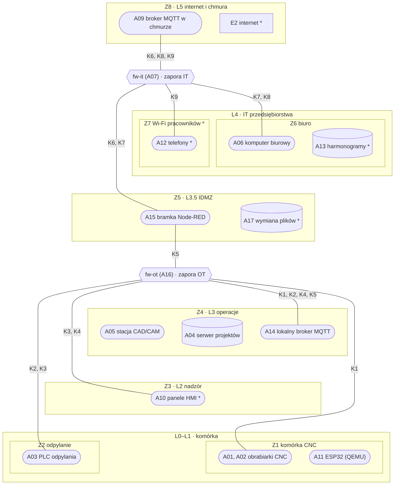

# Model Purdue, strefy i conduity (stan docelowy, `v1`)

Etap 2, zadanie T05. Dokument dzieli zakład na strefy i łączące je conduity według IEC 62443-3-2, z IDMZ na poziomie 3.5 między dwiema zaporami. Wychodzi z [inwentaryzacji](inwentaryzacja-aktywow.md) (aktywa `Axx`) i [przepływów danych](przeplywy-danych.md) (przepływy `Fxx`): każdy przepływ z DFD ma kanał w conduicie albo jest celowo zablokowany. Lab `v1` (T09) realizuje tabele kanałów i zapór regułami nftables, a SL-T dla stref uzasadnia T06.

## Zasady podziału

1. Strefa grupuje aktywa o tych samych wymaganiach bezpieczeństwa i jednym właścicielu. Ruch wewnątrz strefy nie przechodzi przez zaporę.
2. Między strefami przechodzą tylko kanały z tabeli. Wszystko inne zapory odrzucają i logują (polityka drop).
3. Kanał ma stronę inicjującą. Odpowiedzi wracają tym samym połączeniem (conntrack), ale druga strona nie otworzy nowego.
4. IT i OT nie mają wspólnej zapory ani kanału. Każde połączenie biura z produkcją kończy się w IDMZ: od strony IT pilnuje jej fw-it, od strony OT fw-ot.
5. Z internetu nie otwiera się żadne połączenie do zakładu. Dane produkcyjne wychodzą do chmury tylko z bramki w IDMZ.
6. Każda zapora należy do strony, którą chroni: fw-it do IT, fw-ot do OT.

## Strefy

| ID | Strefa | Purdue | Aktywa | Sieć v1 | Właściciel | Dlaczego osobna strefa |
|---|---|---|---|---|---|---|
| Z1 | komórka CNC | L0–L1 | A01, A02, A11 | 10.10.11.0/24 | OT | obrabiarki przyjmują programy i komendy; podmieniony program daje wadliwe wyroby i może przeciążyć wrzeciono |
| Z2 | odpylanie | L0–L1 | A03 | 10.10.12.0/24 | OT | jedyne aktywo, którego wyłączenie zagraża ludziom (wybuch pyłu); osobno od obrabiarek, żeby przejęta obrabiarka nie dotarła do PLC |
| Z3 | nadzór | L2 | A10 | 10.10.20.0/24 | OT | panele operatorów: jedyne miejsce sterowania odpylaniem i komend START/STOP |
| Z4 | operacje | L3 | A04, A05, A14 | 10.10.30.0/24 | OT | projekty, G-code i lokalny broker MQTT; stąd programy trafiają na maszyny |
| Z5 | IDMZ | L3.5 | A15, A17 | 10.10.35.0/24 | OT | jedyne miejsce styku IT z OT i zakładu z chmurą; żadne połączenie nie przechodzi przez nią wprost |
| Z6 | biuro | L4 | A06, A13 | 10.10.40.0/24 | IT | poczta i internet, czyli najbardziej prawdopodobny punkt wejścia atakującego (phishing) |
| Z7 | Wi-Fi pracowników * | L4 | A12 | 10.10.45.0/24 | IT | prywatne telefony poza kontrolą zakładu; mają tylko internet |
| Z8 | internet i chmura | L5 | A09, E1, E2 | 203.0.113.0/24 | zewnętrzna | poza kontrolą zakładu; konto w brokerze A09 należy do OT |

\* poza symulacją. Router A07 staje się zaporą fw-it, a wspólna sieć A08 znika, bo zastępują ją sieci stref. Zapory należą do conduitów, nie do stref. ESP32 (A11) przechodzi z Wi-Fi biura do strefy komórki: w zakładzie przez osobną sieć Wi-Fi OT albo kabel, w labie jako emulator QEMU w sieci Z1 (Etap 5).

## Nowe i zmienione aktywa

| ID | Aktywo | Purdue | Strefa | Właściciel | Zadanie |
|---|---|---|---|---|---|
| A07 | zapora fw-it: dotychczasowy router z NAT, teraz z polityką drop | L3.5–L5 | — | IT | T09 |
| A14 | lokalny broker MQTT (Mosquitto, tylko TLS na 8883, ACL) | L3 | Z4 | OT | T10, T11 |
| A15 | bramka Node-RED: czyta lokalny broker, filtruje i agreguje dane, wysyła je do chmury | L3.5 | Z5 | OT | T12 |
| A16 | zapora fw-ot (nftables) | L1–L3.5 | — | OT | T09 |
| A17 | serwer wymiany plików w IDMZ (plan zleceń) * | L3.5 | Z5 | OT | poza symulacją |

## Własność spornych aktywów

Inwentaryzacja (T03) wskazała aktywa, o które spierają się IT i OT. W `v1` każde ma jednego właściciela:

- **A04, serwer projektów → OT.** Przechodzi do strefy operacji. Jeśli fizycznie zostaje we wspólnej serwerowni, to na osobnym sprzęcie podłączonym do sieci Z4. Z biura nie ma do niego dostępu.
- **A05, stacja CAD/CAM → OT.** Decyduje o programach na maszynach, więc jest w Z4, bez poczty i internetu. Pocztę konstruktor czyta na komputerze w biurze.
- **A07, router → IT** jako zapora fw-it.
- **A09, broker w chmurze → OT.** Konto i dane należą do produkcji, a jedynym klientem w zakładzie jest bramka A15.
- **IDMZ i fw-ot → OT.** OT decyduje, jakie dane wychodzą z produkcji, a IT na fw-it decyduje, co z biura dociera do IDMZ.

## Schemat Purdue (to-be)

Sześciokąt to zapora, a etykieta linii to conduity, które przechodzą przez dany interfejs zapory. Biuro (L4) i strefy OT (L0–L3) nie mają wspólnej zapory, więc każde połączenie między nimi kończy się w IDMZ. Z biura do produkcji trafia tylko plan zleceń, i to dwoma osobnymi połączeniami: biuro odkłada go na serwerze wymiany A17, a stacja CAD/CAM sama go stamtąd pobiera.

## Zapory

| Zapora | Interfejsy | Rola |
|---|---|---|
| fw-it | Z8 (203.0.113.2), Z6 (10.10.40.254), Z7 (10.10.45.254), Z5 (10.10.35.254) | NAT do internetu; kanały K6–K9 |
| fw-ot | Z5 (10.10.35.253), Z4 (10.10.30.254), Z3 (10.10.20.254), Z1 (10.10.11.254), Z2 (10.10.12.254) | kanały K1–K5, bez NAT |

Obie zapory działają w rodzinie `inet` (IPv4 i IPv6) z polityką drop w łańcuchach `input` i `forward`. Przepuszczają ruch powrotny (`ct state established,related`) i kanały z tabeli niżej, a resztę logują z prefiksem `fw-it drop` albo `fw-ot drop`. Zapór nie da się zarządzać z sieci: w labie zmiany robimy przez `docker exec`. Hosty w IDMZ mają trasę domyślną przez fw-it, a trasę do strefy operacji przez fw-ot. Hosty w strefach OT mają trasę domyślną przez swój interfejs fw-ot.

## Conduity

| ID | Strefy | Zapora | Kanały | Po co |
|---|---|---|---|---|
| K1 | Z4, Z1 | fw-ot | C01, C02, C03 | programy G-code na maszyny; telemetria i komendy przez lokalny broker |
| K2 | Z4, Z2 | fw-ot | C04 | stan odpylania do lokalnego brokera |
| K3 | Z3, Z2 | fw-ot | C05 | sterowanie odpylaniem z panelu |
| K4 | Z3, Z4 | fw-ot | C06 | podgląd i komendy operatora |
| K5 | Z5, Z4 | fw-ot | C07, C08 | dane dla bramki; plan zleceń z IDMZ |
| K6 | Z5, Z8 | fw-it | C09 | jedyne wyjście danych produkcyjnych do chmury |
| K7 | Z6, Z5 | fw-it | C10 | plan zleceń z biura do IDMZ |
| K8 | Z6, Z8 | fw-it | C11 | praca biurowa: WWW i poczta |
| K9 | Z7, Z8 | fw-it | C12 | internet dla telefonów |

## Kanały

Kanał to dozwolony przepływ między strefami. „Inicjator” wyznacza kierunek: tylko ta strona otwiera połączenie. Kanały z `*` nie mają jeszcze odpowiednika w labie `v1`, bo dotyczą aktywów poza symulacją albo z Etapu 5. Przepływy `N` są nowe w `v1` i opisuje je tabela pod listą kanałów.

| ID | Conduit | Źródło → cel | Inicjator | Protokół i port | Przepływy | Uzasadnienie |
|---|---|---|---|---|---|---|
| C01 | K1 | A05 → A01, A02 | A05 | HTTP 8080/tcp | F05 | programy wysyła tylko stacja CAD/CAM; w `v0` mogło to zrobić każde urządzenie |
| C02 | K1 | A01, A02 → A14 | A01, A02 | MQTT 8883/tcp, TLS | F01, N01 | telemetria do lokalnego brokera i subskrypcja komend; maszyny nie łączą się z chmurą |
| C03 * | K1 | A11 → A14 | A11 | MQTT 8883/tcp, TLS | F08 | prąd wrzeciona z ESP32 (Etap 5); alarm działa lokalnie także bez tego kanału |
| C04 | K2 | A03 → A14 | A03 | MQTT 8883/tcp, TLS | F03 | stan odpylania; PLC nie przyjmuje żadnych połączeń ze strefy operacji |
| C05 * | K3 | A10 → A03 | A10 | Modbus TCP 502/tcp | F09 | jedyny klient Modbus; protokół nie ma uwierzytelnienia, więc PLC chroni tylko ten kanał |
| C06 * | K4 | A10 → A14 | A10 | MQTT 8883/tcp, TLS | N01 | operator widzi telemetrię i wydaje START/STOP przy maszynie |
| C07 | K5 | A15 → A14 | A15 | MQTT 8883/tcp, TLS | F01, F03, F08 | bramka czyta telemetrię, stan odpylania i prąd wrzeciona kontem tylko do odczytu (T11); to jedyny kanał z IDMZ do OT |
| C08 * | K5 | A05 → A17 | A05 | HTTPS 443/tcp | F12 | stacja CAD/CAM pobiera plan zleceń z IDMZ |
| C09 | K6 | A15 → A09 | A15 | MQTT 8883/tcp, TLS | F01, F03, F08 | do chmury trafiają tylko dane wybrane i zagregowane przez bramkę (T12), przez NAT na fw-it |
| C10 * | K7 | A13 → A17 | A13 | HTTPS 443/tcp | F12 | biuro odkłada plan zleceń w IDMZ i nie widzi OT |
| C11 * | K8 | A06 → E2 | A06 | HTTPS 443/tcp, poczta 587/tcp i 993/tcp | F10 | praca biurowa, przez NAT na fw-it |
| C12 * | K9 | A12 → E2 | A12 | HTTPS 443/tcp | F10 | telefony mają tylko internet |

| ID | Przepływ nowy w `v1` | Kanały |
|---|---|---|
| N01 | podgląd telemetrii i komendy START/STOP z panelu operatora: A10 → A14 → A01, A02 | C06, C02 |

## Przepływy z DFD w `v1`

| Przepływ | W v1 | Kanały | Uzasadnienie |
|---|---|---|---|
| F01 | przez IDMZ | C02, C07, C09 | maszyny piszą do lokalnego brokera, a do chmury dane wysyła tylko bramka; bezpośrednie połączenie maszyn z chmurą jest zablokowane |
| F02 | zablokowany | — | sterowania z chmury nie ma, bo niespodziewany START zagraża operatorowi (T03); START/STOP wydaje tylko operator z panelu (N01) |
| F03 | przez IDMZ | C04, C07, C09 | jak F01 |
| F04 | w strefie Z4 | — | serwer projektów i stacja CAD/CAM są w jednej strefie |
| F05 | przez conduit | C01 | jedyny kanał do portu 8080 obrabiarek |
| F06 | w strefie Z8 | — | przepływ w chmurze; zakład decyduje tylko, co tam wysyła (C09) |
| F07 | zablokowany | — | komendy z chmury nie mają drogi do OT: bramka nie subskrybuje w chmurze tematów komend, a fw-it nie wpuszcza połączeń z internetu |
| F08 | przez IDMZ | C03, C07, C09 | ESP32 pisze do lokalnego brokera, a do chmury trafia tylko to, co wybierze bramka; alarm działa lokalnie |
| F09 | przez conduit | C05 | jedyny kanał do PLC |
| F10 | przez conduit | C11, C12 | biuro i telefony wychodzą do internetu, ale nie do OT |
| F11 | w strefie Z6 | — | komputer biurowy i harmonogramy są w jednej strefie |
| F12 | przez IDMZ | C10, C08 | biuro i stacja CAD/CAM łączą się tylko z serwerem wymiany A17; bezpośrednie połączenie biura ze strefą operacji jest zablokowane |
| F13 | w strefie Z4 | — | jak F04 |

## Co zamykają conduity

Ścieżki ataku z T04 („Co sieć umożliwia poza przepływami”) w `v1`:

| Ścieżka w `v0` | W `v1` |
|---|---|
| każde urządzenie łączy się z PLC na Modbus 502 | tylko panel A10 (C05); PLC jest sam w strefie Z2 |
| każde urządzenie wysyła program na obrabiarkę na port 8080 | tylko stacja CAD/CAM A05 (C01) |
| każde urządzenie pobiera projekty z serwera A04 | serwer jest osiągalny tylko w strefie Z4; żaden kanał do niego nie prowadzi |
| klient z internetu czyta telemetrię i publikuje komendy w brokerze A09 | do A09 trafiają tylko dane wybrane przez bramkę, a komendy z chmury nie docierają do OT (F02, F07); dostęp do samego brokera w chmurze ogranicza TLS i konto bramki (T12) |

Ryzyka, które zostają:

- Wewnątrz strefy ruch nie jest filtrowany. Przejęta obrabiarka widzi drugą, a G-code nadal idzie jawnym HTTP (C01), więc podmiana w locie jest możliwa z urządzenia w Z4 albo Z1. Sprawdzanie integralności programu przez obrabiarkę rozważy T15 i T16.
- Bramka A15 jest jedynym aktywem IDMZ z kanałem do OT. Po jej przejęciu atakujący dostaje tylko odczyt z brokera (ACL) i tylko port 8883.

## Co z tego wynika dla kolejnych zadań

- **T06:** SL-T dla stref Z1–Z7. Z8 jest strefą zewnętrzną, poza kontrolą zakładu.
- **T09:** sieci Dockera `internal` dla stref Z1–Z6 i Z8 (Z7 jest poza symulacją), kontenery fw-it i fw-ot z interfejsami z tabeli zapór, reguły z kanałów bez `*`. Testy odwrotne do `v0`: z biura nie ma połączenia z obrabiarką na 8080, z PLC na 502, z serwerem projektów na 80 ani z brokerem A14. Kanały MQTT mogą do czasu T10 działać na 1883 bez TLS.
- **T10–T12:** broker A14 tylko na 8883 z TLS. Konta i ACL zgodne z kanałami: bramka tylko czyta, a tematy komend obsługuje tylko lokalny broker. Bramka A15 jest jedynym klientem brokera w chmurze.
