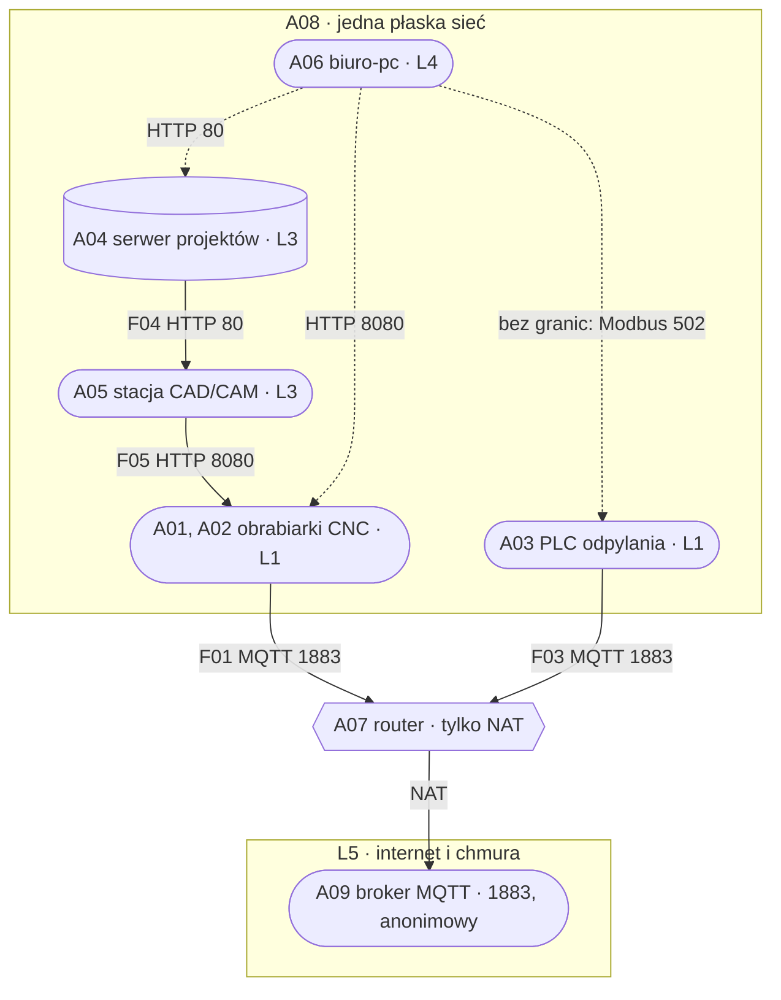
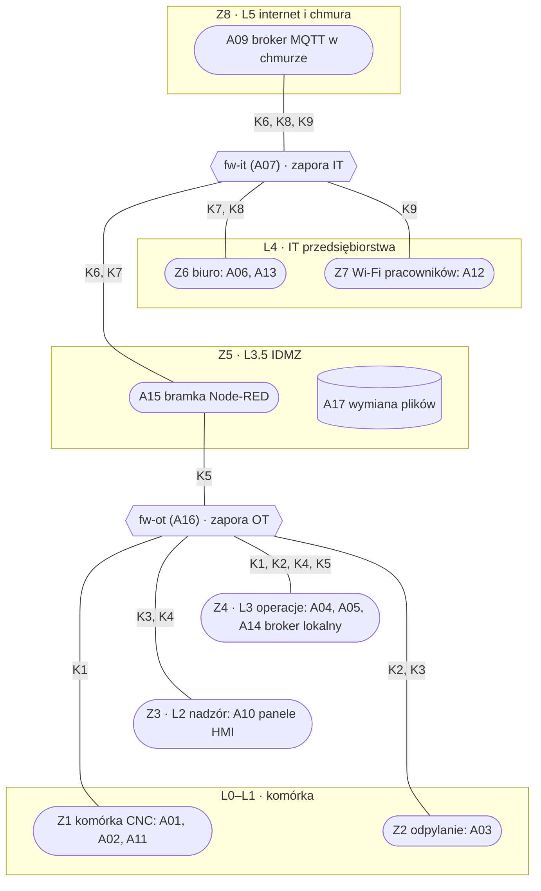

# Etapy 1–2 — Inwentaryzacja aktywów, przepływy danych, model Purdue i SL-T

Data: 2026-11-24

## Cel

Opisać zakład Wood-Tech CNC w stanie as-is, czyli co w nim jest i jakie dane płyną, a potem zaprojektować docelowy podział sieci według modelu Purdue i IEC 62443. Projekt obejmuje strefy, conduity, IDMZ i docelowe poziomy bezpieczeństwa (SL-T) i jest podstawą zabezpieczeń w Etapie 3 oraz modelowania zagrożeń w Etapie 4.

## Co zrobiliśmy

1. **Lab `v0`** odtwarza stan as-is w Docker Compose ([lab/README.md](../../lab/README.md)): jedna płaska sieć dla biura, serwerowni i hali, router tylko z NAT, maszyny wysyłające MQTT wprost do chmury bez TLS i hasła.
2. **Inwentaryzacja aktywów** ([inwentaryzacja-aktywow.md](../architektura/inwentaryzacja-aktywow.md)): 13 aktywów z poziomem Purdue, adresem, protokołami, właścicielem (IT albo OT) i krytycznością. Test pilnuje zgodności tabeli z kontenerami labu.
3. **Przepływy danych** ([przeplywy-danych.md](../architektura/przeplywy-danych.md)): DFD z trzema granicami zaufania i 13 przepływami. Każdy przepływ ma inicjatora, protokół i port, szyfrowanie i uwierzytelnienie. Przepływy z labu potwierdziliśmy nagraniem ruchu.
4. **Model Purdue, strefy i conduity** ([strefy-i-conduity.md](../architektura/strefy-i-conduity.md)): osiem stref, dwie zapory (fw-it, fw-ot) z IDMZ między nimi, dziewięć conduitów i 12 dozwolonych kanałów. Każdy przepływ z DFD ma kanał, odbywa się w jednej strefie albo jest celowo zablokowany.
5. **SL-T** ([sl-t.md](../architektura/sl-t.md)): docelowy poziom każdej strefy jako wektor FR1–FR7, z profilem atakującego i uzasadnieniem skutkiem. Do tego SL-T conduitów i luka względem `v0`.

Najważniejsze decyzje:

- Komendy START/STOP z chmury są w `v1` zablokowane, bo niespodziewany START zagraża operatorowi. Maszynę uruchamia tylko operator z panelu.
- Odpylanie ma osobną strefę, bo tylko jego wyłączenie zagraża ludziom (wybuch pyłu drzewnego).
- Spór IT/OT o współdzielone aktywa rozstrzygamy zasadą „zapora należy do strony, którą chroni”. Serwer projektów, stacja CAD/CAM, IDMZ i fw-ot należą do OT, a fw-it do IT.
- Do chmury dane wychodzą tylko przez bramkę Node-RED w IDMZ, a biuro nie ma żadnego kanału do OT.

## Dowody

### Tabela inwentaryzacji

| ID | Aktywo | W labie | Purdue | Właściciel | Krytyczność | Strefa w `v1` |
|---|---|---|---|---|---|---|
| A01 | Obrabiarka CNC 1 | `cnc-1` | L1 | OT | Krytyczna | Z1 komórka CNC |
| A02 | Obrabiarka CNC 2 | `cnc-2` | L1 | OT | Krytyczna | Z1 komórka CNC |
| A03 | PLC centralnego odpylania | `plc-odpylanie` | L1 | OT | Krytyczna | Z2 odpylanie |
| A04 | Serwer projektów | `serwer` | L3 | IT | Wysoka | Z4 operacje |
| A05 | Stacja CAD/CAM konstruktora | `cad-stacja` | L3 | IT | Wysoka | Z4 operacje |
| A06 | Komputer biurowy (w labie przejęty) | `biuro-pc` | L4 | IT | Średnia | Z6 biuro |
| A07 | Router zakładowy z NAT | `router` | L4 | IT | Wysoka | zapora fw-it |
| A08 | Sieć zakładu (wspólny przełącznik) | sieć `zaklad` | L1–L4 | IT | Krytyczna | zastąpiona sieciami stref |
| A09 | Broker MQTT w chmurze | `chmura-mqtt` | L5 | OT | Krytyczna | Z8 internet i chmura |
| A10 | Panele HMI operatorów | poza symulacją | L2 | OT | Wysoka | Z3 nadzór |
| A11 | Węzeł ESP32 z czujnikiem prądu | poza symulacją | L1 | OT | Wysoka | Z1 komórka CNC |
| A12 | Wi-Fi z telefonami pracowników | poza symulacją | L4 | IT | Wysoka | Z7 Wi-Fi pracowników |
| A13 | Harmonogramy produkcji | poza symulacją | L4 | IT | Średnia | Z6 biuro |

Purdue, właściciel i krytyczność opisują stan as-is. Pełna tabela z adresami, protokołami i uzasadnieniem krytyczności jest w [inwentaryzacji](../architektura/inwentaryzacja-aktywow.md).

### Schemat sieci as-is (`v0`)

Biuro, serwerownia i hala są w jednej podsieci 10.10.0.0/24, a „internet” labu to 203.0.113.0/24. Linia ciągła to przepływ z DFD, przerywana to ścieżka ataku z biura, którą potwierdzają testy `v0` ([tests/security](../../tests/security/test_v0_podatnosci.py)).

### Schemat sieci to-be (`v1`)

Etykiety linii to conduity, które przechodzą przez dany interfejs zapory. Biuro i OT nie mają wspólnej zapory: wszystko, co łączy IT z OT, kończy się w IDMZ.

### Nagranie ruchu i testy

- [evidence/etap-1-2/](../../evidence/etap-1-2/): ruch labu `v0` nagrany przez 140 s od startu na obu mostach Dockera (`v0-zaklad.pcap`, `v0-internet.pcap`). W [v0-polaczenia.txt](../../evidence/etap-1-2/v0-polaczenia.txt) jest 7 połączeń i każde należy do przepływu z DFD. Poza nimi w ruchu jest tylko ARP i ICMPv6 hosta.
- `make unit` sprawdza spójność dokumentów z labem i ze sobą: inwentaryzacja z compose, DFD z nagraniem, strefy z DFD (każdy przepływ ma kanał albo jest zablokowany, biuro nie ma drogi do OT), SL-T ze strefami i conduitami, a tabela wyżej z inwentaryzacją.
- `make test-security` na labie `v0` potwierdza, że z przejętego komputera biurowego da się czytać telemetrię z chmury, pobrać projekt z serwera, dostać się do API obrabiarki i odczytać rejestry PLC.

### SL-T stref

| Strefa | Purdue | SL-T | FR na poziomie 3 | Atakujący |
|---|---|---|---|---|
| Z1 | L0–L1 | 3 | FR2, FR3 | P3 |
| Z2 | L0–L1 | 3 | FR1, FR2, FR3, FR5, FR7 | P3 |
| Z3 | L2 | 3 | FR2 | P3 |
| Z4 | L3 | 3 | FR3, FR4 | P3 |
| Z5 | L3.5 | 3 | FR1, FR5 | P2, P3 |
| Z6 | L4 | 1 | — | P2 |
| Z7 | L4 | 0 | — | — |
| Z8 | L5 | 0 | — | — |

P2 to cyberprzestępca z gotowymi narzędziami (phishing, ransomware), a P3 to atakujący ukierunkowany z wiedzą o systemach sterowania. Pełne wektory i uzasadnienia są w [sl-t.md](../architektura/sl-t.md).

## Wnioski

1. Największym problemem `v0` jest brak granic: z biura da się dotrzeć do PLC i obrabiarek, a maszyny wysyłają jawne MQTT wprost do chmury. Strefy i dwie zapory z IDMZ zamykają te ścieżki (lab `v1`, T09).
2. Komunikacja w Etapie 3 musi dać TLS i ACL na każdym kanale MQTT (C02, C04, C07, C09) i bramkę Node-RED jako jedyne wyjście do chmury (T10–T12).
3. Najsłabszym punktem względem SL-T jest integralność G-code (FR3 w Z1 i Z4), bo program nadal idzie jawnym HTTP wewnątrz OT. To główny temat Etapu 4 (Tampering).
4. PLC odpylania nie uwierzytelnia klientów Modbus, więc chroni go tylko conduit K3 z jednym dozwolonym klientem.

## Problemy i ograniczenia

- Panele HMI, Wi-Fi z telefonami, harmonogramy i serwer wymiany plików w IDMZ są poza symulacją. Ich kanały są opisane, ale nie testowane.
- ESP32 dochodzi dopiero w Etapie 5 (emulator QEMU), więc jego kanał C03 też jest na razie tylko opisany.
- Ruch wewnątrz strefy nie jest filtrowany, a G-code w `v1` nadal jest jawny. Podmiana programu w locie jest możliwa z urządzenia w strefie operacji albo komórki.
- Na Debianie mosty Dockera wysyłają przy starcie pakiety ICMPv6 z adresów link-local. Kontrola nagrania je dopuszcza, bo to ruch systemu hosta, a nie labu.
- Schematy są w Mermaid: GitHub rysuje je w przeglądarce, a do wydruku trzeba je wyeksportować.
