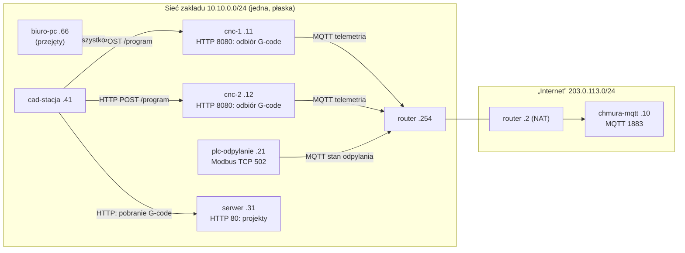

# Lab Wood-Tech CNC

Symulowana fabryka w Docker Compose. Wszystkie urządzenia, router i „chmura” to kontenery; lab nie ma wyjścia do prawdziwego internetu.

## Wymagania (Debian)

- Docker Engine z pluginem compose (`docker-ce`, `docker-compose-plugin` z repozytorium Dockera), użytkownik w grupie `docker`;
- `make`, `tcpdump` i `openssl` (`sudo apt install make tcpdump openssl`) oraz mise z narzędziami z `mise.toml` (`make doctor` sprawdza całość);
- Wireshark na komputerze, na którym oglądamy ruch (może być Windows, patrz niżej).

Cały lab `v0` zajmuje ok. 80 MB RAM.

## v0 — sieć niebezpieczna (stan as-is)

```bash
make v0-up        # albo make v0-up-atak: z przejętym komputerem biurowym (biuro-pc)
make v0-status    # kontenery i pamięć
make v0-logs      # logi symulatorów (JSON)
make v0-mqtt      # cała telemetria widziana w brokerze „w chmurze”
make v0-down
```

### Topologia



| Kontener | Adres | Rola w scenariuszu | Usługi i protokoły |
|---|---|---|---|
| `router` | 10.10.0.254, 203.0.113.2 | router zakładowy (outsourcing IT) | NAT, bez filtrowania (`v0/router/nftables.nft`) |
| `chmura-mqtt` | 203.0.113.10 | broker MQTT dostawcy chmury | MQTT 1883, anonimowy, bez TLS i ACL |
| `cnc-1`, `cnc-2` | 10.10.0.11, .12 | obrabiarki CNC | HTTP 8080 (`POST /program`, `GET /status`), MQTT: telemetria i komendy START/STOP |
| `plc-odpylanie` | 10.10.0.21 | PLC centralnego odpylania | Modbus TCP 502 (cewki: wentylator, przepustnica; rejestry: obroty, podciśnienie, pył), MQTT: stan |
| `serwer` | 10.10.0.31 | współdzielona serwerownia, pliki projektów | HTTP 80, `/projekty/*.nc` |
| `cad-stacja` | 10.10.0.41 | stacja CAD/CAM konstruktora | co 30 s pobiera projekt i wysyła go na kolejną maszynę |
| `biuro-pc` | 10.10.0.66 | komputer biurowy przejęty przez atakującego | nmap, tcpdump, mosquitto-clients, arpspoof (dsniff), scapy, pymodbus |

Tematy MQTT: `wood-tech/hala1/<cnc>/telemetria`, `wood-tech/hala1/<cnc>/komenda`, `wood-tech/hala1/odpylanie/stan`.

### Celowe słabości v0

Odwzorowują opis scenariusza i są punktem wyjścia dla Etapów 1–4:

1. Płaska sieć: biuro, serwerownia i hala w jednej podsieci, router niczego nie filtruje.
2. MQTT do chmury bez TLS: telemetria i komendy jawnym tekstem przez internet.
3. Broker anonimowy bez ACL: każdy może czytać wszystkie tematy i publikować komendy (np. `STOP` dla CNC).
4. G-code przesyłany jawnym HTTP bez uwierzytelnienia i bez kontroli integralności: można go podsłuchać (kradzież projektu) i podmienić w locie (Tampering).
5. Modbus TCP bez uwierzytelnienia: każdy w sieci może wyłączyć wentylator odpylania.
6. Brak lokalnej bramki: maszyny łączą się bezpośrednio z chmurą.

### Podgląd ruchu w Wiresharku

Wszystko, co przechodzi przez sieć zakładu, widać na interfejsie `wt0-zaklad` na Debianie.

```bash
make v0-capture CZAS=120   # zapis do evidence/v0-<data>.pcap
make v0-nagranie CZAS=140  # bez sudo: start labu z nagrywaniem obu sieci od pierwszego pakietu
make v0-analiza            # nagranie ze scenariuszem ataku z biura i zrzuty tshark (evidence/etap-3/)
```

Na żywo z Windowsa (Wireshark w `C:\Program Files\Wireshark`):

```powershell
ssh uzytkownik@debian "sudo tcpdump -i wt0-zaklad -U -w - not port 22" | & "C:\Program Files\Wireshark\Wireshark.exe" -k -i -
```

## v1 — sieć zabezpieczona (stan to-be)

```bash
make v1-up          # albo make v1-up-atak: z przejętym komputerem biurowym (biuro-pc)
make v1-status      # kontenery i pamięć
make v1-logs        # logi symulatorów (JSON)
make test-segmentacja  # testy: dozwolone kanały działają, z biura nie ma drogi do OT (najpierw v1-up-atak)
make v1-down
```

v1 realizuje model stref i conduitów z [`docs/architektura/strefy-i-conduity.md`](../docs/architektura/strefy-i-conduity.md) (T05).
Każda strefa to osobna sieć Dockera, a ruch między strefami idzie wyłącznie przez zaporę: hosty mają trasę
domyślną przez swój interfejs zapory, więc nie przeskoczą do innej strefy z pominięciem filtrowania.

Dwie zapory nftables z polityką `drop` w `forward` (przechodzi tylko ruch powrotny i jawne kanały):

- **fw-ot** (A16) — styk stref OT (Z1 komórka, Z2 odpylanie, Z3 nadzór, Z4 operacje) z IDMZ (Z5);
- **fw-it** (A07, dawny router z NAT) — styk IDMZ i biura (Z6) z internetem (Z8). Biuro nie ma interfejsu
  w żadnej strefie OT, więc z biura nie istnieje droga do OT.

| Strefa | Podsieć | Kontenery w labie |
|---|---|---|
| Z1 komórka CNC | 10.10.11.0/24 | `cnc-1` .11, `cnc-2` .12 |
| Z2 odpylanie | 10.10.12.0/24 | `plc-odpylanie` .21 |
| Z4 operacje | 10.10.30.0/24 | `broker-lokalny` (A14) .14, `serwer` .31, `cad-stacja` .41 |
| Z5 IDMZ | 10.10.35.0/24 | bramka Node-RED A15 dochodzi w T12 |
| Z6 biuro | 10.10.40.0/24 | `biuro-pc` .66 (przejęty, tylko profil `atak`) |
| Z8 internet/chmura | 203.0.113.0/24 | `chmura-mqtt` .10 |

Zapory adresem interfejsu kończą każdą strefę: fw-ot ma .254 w Z1–Z4 i .253 w Z5, fw-it .254 w Z5/Z6 i
203.0.113.2 w Z8. Kanały zrealizowane w labie: CAD → obrabiarki (G-code 8080), obrabiarki i PLC →
lokalny broker A14 (MQTT 1883), bramka IDMZ → A14 oraz → chmura (T12), biuro → internet (443/587/993).

### Co zmienia się względem v0

1. Płaską sieć zastępują strefy Purdue z IDMZ na poziomie 3.5; dwie zapory zamiast jednego routera bez filtrowania.
2. Maszyny piszą telemetrię do **lokalnego** brokera A14 w strefie operacji, a nie wprost do chmury.
3. Z przejętego biura nie ma już drogi do obrabiarek (8080), serwera projektów (80), PLC (Modbus 502)
   ani do lokalnego i chmurowego brokera MQTT — potwierdzają to testy odwrotne do słabości v0.

Na razie (do T10) MQTT działa jawnie na 1883 i broker jest anonimowy — jak w v0. TLS daje T10, konta i ACL
daje T11, a bramkę Node-RED z IDMZ do chmury T12.
